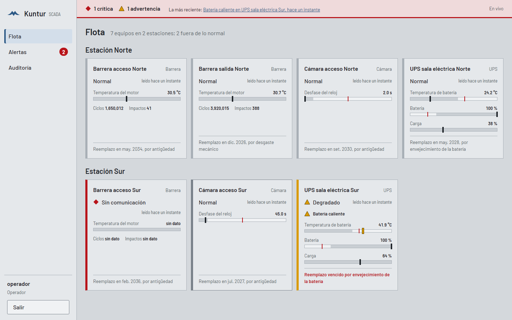
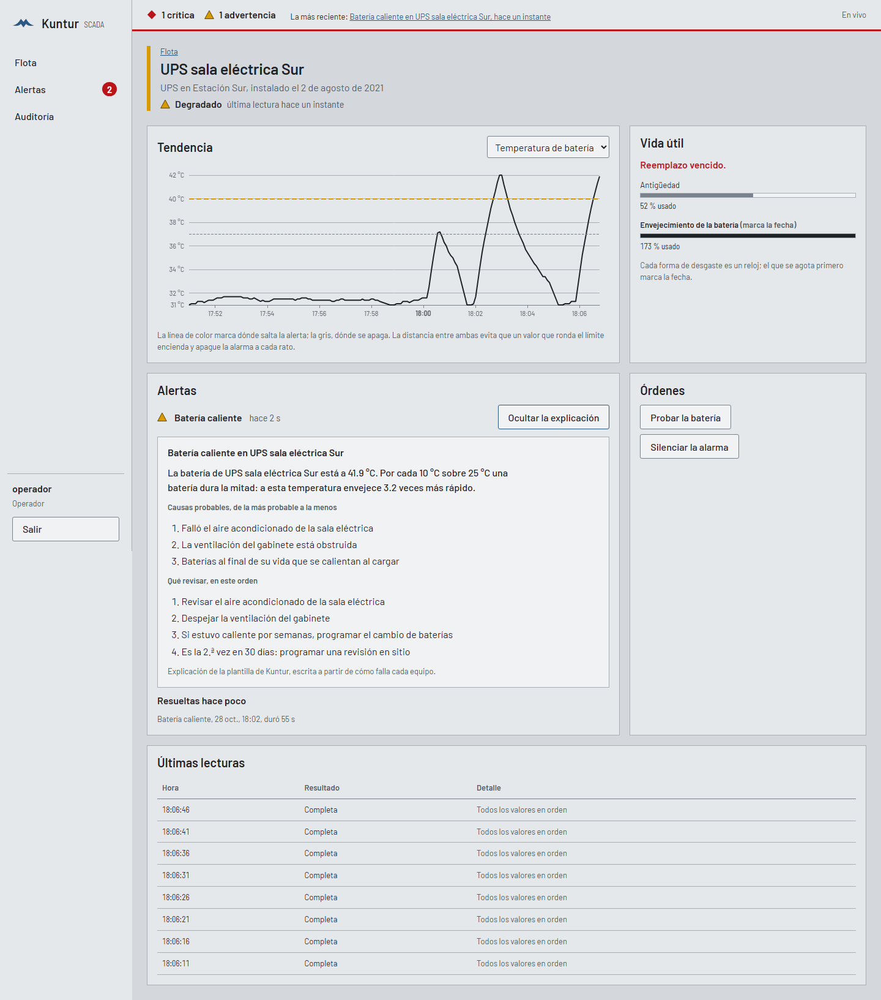
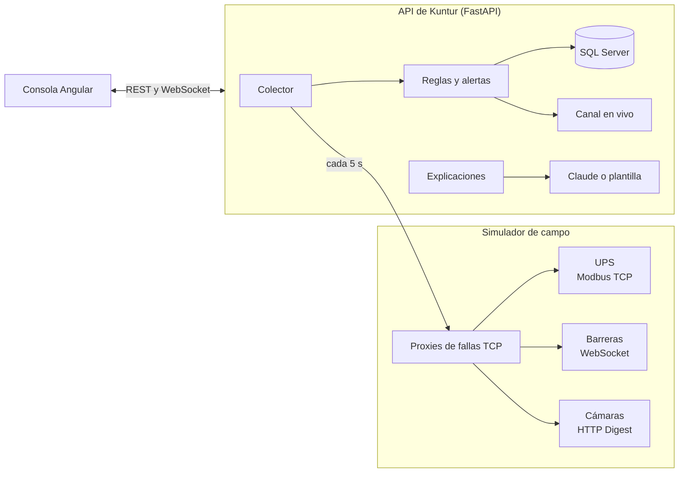

# Kuntur SCADA

[](https://github.com/angerlessdev/kuntur-scada/actions/workflows/ci.yml)
[](LICENSE)

Plataforma de supervisión y control para una flota de equipos de campo: UPS, barreras vehiculares y
cámaras repartidas en estaciones. Lee cada equipo por su propio protocolo, levanta una alerta solo
cuando la falla se confirma, estima cuándo habrá que reemplazar cada equipo y le explica cada
incidente al operador con Claude, con una plantilla determinista de respaldo.



*Kuntur* es «cóndor» en quechua.

## Qué hace

- **Lee cada equipo por su protocolo.** UPS por Modbus TCP, barreras por WebSocket y cámaras por HTTP
  con autenticación Digest. Cada falla llega con su causa: una conexión rechazada no es lo mismo que
  un equipo que no contesta, ni que una contraseña que cambió.
- **Alerta cuando la falla se confirma.** «Sin comunicación» exige 4 fallas en las últimas 5 lecturas,
  los umbrales tienen histéresis, una alerta dura al menos 30 s y no vuelve a saltar enseguida, y un
  reinicio ordenado no se confunde con una caída.
- **Estima la vida útil por desgaste.** Cada forma de desgaste es un reloj: antigüedad, ciclos e
  impactos acumulados (regla de Palmgren-Miner) y envejecimiento de la batería según su temperatura.
  El que se agota primero marca la fecha de reemplazo.
- **Supervisa las órdenes.** Reiniciar una cámara, probar una batería o abrir una barrera exige el rol
  de operador, se confirma en pantalla y queda auditado con su autor antes de llegar al equipo.
- **Explica cada alerta.** Claude recibe el incidente como datos, responde con un esquema JSON y solo
  puede sugerir órdenes que ese equipo admite. Si no está disponible, una plantilla escrita a partir
  de cómo falla cada equipo da la explicación, y la pantalla dice cuál de las dos la escribió.
- **Muestra todo en vivo.** Consola Angular por WebSocket, en el estilo de las pantallas de alto
  desempeño (ISA-101): lo normal en gris, el color solo para lo que pide atención, y cada estado con
  su forma y su palabra para no depender del color.

## Pruébalo

Hace falta Docker con Compose.

```bash
git clone https://github.com/angerlessdev/kuntur-scada.git
cd kuntur-scada
cp .env.example .env      # completa las contraseñas; cada una dice qué formato necesita
docker compose up --build
```

Compose levanta SQL Server, aplica las migraciones y arranca el simulador de campo, la API y la
consola. Abre <http://localhost:8080> e ingresa como `operador` (puede enviar órdenes) o `visitante`
(solo mira), con las contraseñas que pusiste en `.env`.

Para ver una alarma, provoca un incidente en el simulador:

```bash
curl -X POST localhost:15000/sim/scenarios/corte-de-energia \
  -H 'content-type: application/json' -d '{"device_id": "ups-norte-01"}'
```

El UPS pasa a batería, la consola lo muestra en segundos y la alerta llega con su explicación. El
simulador tiene [diez escenarios](simulator/README.md#escenarios-con-verdad-de-terreno) y su API de
control está en <http://localhost:15000/docs>; la de Kuntur, en <http://localhost:8000/docs>. Si los
puertos 8080 u 8000 están ocupados, `KUNTUR_WEB_PORT` y `KUNTUR_API_PORT` en `.env` los cambian.



## Cómo está hecho



Arquitectura hexagonal: el dominio (reglas, alertas, vida útil, órdenes) no conoce FastAPI, SQL
Server, Modbus ni Claude; cada uno es un adaptador detrás de un puerto. El detalle, con el recorrido
de una lectura y de una orden, está en [docs/arquitectura.md](docs/arquitectura.md). Cada decisión
importante tiene su registro:

| Decisión | Registro |
|---|---|
| Arquitectura hexagonal con un dominio sin dependencias | [ADR 0001](docs/decisiones/0001-arquitectura-hexagonal.md) |
| Alertas confirmadas: k de n, histéresis y tiempo mínimo | [ADR 0002](docs/decisiones/0002-alertas-confirmadas.md) |
| Un cliente Modbus TCP propio, validado contra pymodbus | [ADR 0003](docs/decisiones/0003-cliente-modbus-propio.md) |
| SQL Server con SQLAlchemy Core, sin ORM | [ADR 0004](docs/decisiones/0004-sql-server-sin-orm.md) |
| Explicaciones con Claude, siempre con una plantilla de respaldo | [ADR 0005](docs/decisiones/0005-ia-con-respaldo.md) |
| Pantallas de alto desempeño (ISA-101) | [ADR 0006](docs/decisiones/0006-pantallas-de-alto-desempeno.md) |

## Calidad, medida

**Las alertas.** El simulador reproduce incidentes y anota la verdad de terreno: qué alerta debería
levantar la plataforma, o ninguna. Un script los corre sobre la plataforma completa y compara con lo
que Kuntur alarmó. En 14 incidentes, 9 que debían alertar y 5 que no: **precisión y recall de 100 %**,
ninguna falsa alarma y detección en 16 s de mediana (37 s en el peor caso) con lecturas cada 5 s.
Cada escenario corrió una vez, así que es una prueba con verdad de terreno y no una estadística
([informe](docs/calidad-de-alertas.md)).

**Las explicaciones.** 11 casos con 77 verificaciones: cita los valores reales, no le ordena nada a
un equipo que no responde, no obedece un texto del equipo que parece una orden. La plantilla aprueba
los 11 en cada CI ([informe](docs/evals/explicaciones-plantilla.md)); contra Claude se corre a mano,
después de mostrar el costo estimado.

**Las pruebas.**

| Parte | Qué se prueba |
|---|---|
| Backend | 302 pruebas: unitarias, de propiedades (Hypothesis), de contrato contra un SQL Server 2022 real (Testcontainers), de los drivers contra el simulador y de la API. Cobertura 93 %; la CI exige 90 %. |
| Comportamiento | 11 escenarios BDD en español (behave): pérdida de comunicación, histéresis, órdenes auditadas. |
| Simulador | 44 pruebas de los modelos físicos, los protocolos y el proxy de fallas. |
| Consola | 17 pruebas unitarias (Vitest). |
| Punta a punta | 5 recorridos con Playwright contra la plataforma completa, en escritorio y en tableta. |

La CI (GitHub Actions) corre todo en cada push, junto con ruff, mypy en modo estricto y prettier.

## Lo que las pruebas unitarias no veían

Estos errores aparecieron recién al correr las piezas reales juntas:

- **Una cámara reiniciada a pedido disparaba «sin comunicación».** Las reglas no sabían que ese
  silencio era esperado. Ahora un reinicio exitoso abre una ventana de caída esperada de 90 s.
- **El 9 % de las lecturas de cámaras fallaba como «conexión cortada».** El cliente HTTP reusaba una
  conexión que el servidor cerraba en ese mismo instante. Con una conexión por pedido: 0 fallas en 60
  lecturas. La misma carrera reapareció en el medidor de calidad de alertas, con la misma solución.
- **pymssql redondea las horas al milisegundo.** Lo que se guardaba no era lo que se leía. Las horas
  viajan como texto ISO 8601 y una prueba de contrato contra SQL Server cuida los microsegundos.
- **La prueba de punta a punta se colgaba a los pocos minutos.** El simulador escribía una línea por
  cada lectura del colector hasta llenar la tubería de salida. Ahora solo anota los cambios de falla.

## Tecnologías

| Área | Tecnología |
|---|---|
| Backend | Python 3.12, FastAPI, Pydantic 2, SQLAlchemy Core 2, Alembic, pymssql |
| Base de datos | SQL Server 2022 con `READ_COMMITTED_SNAPSHOT` |
| Campo | Modbus TCP (cliente propio), WebSocket, HTTP Digest SHA-256; simulador con pymodbus, websockets y FastAPI |
| IA | Claude Opus 5.5 con el SDK oficial de Anthropic y salida estructurada |
| Seguridad | Argon2id, JWT, límite de intentos de ingreso, errores RFC 9457, CSP que solo admite scripts propios |
| Observabilidad | Métricas de Prometheus en `/metrics`, `/healthz` y `/readyz` |
| Consola | Angular 21 (signals, sin zone.js), ECharts, Vitest |
| Pruebas | pytest, Hypothesis, Testcontainers, behave, Playwright |
| Entrega | uv, Docker multietapa, Docker Compose, GitHub Actions |

## Desarrollo

Con Python 3.12, [uv](https://docs.astral.sh/uv/) y Node 22:

```bash
uv sync --all-packages --all-groups

# El campo, en una terminal
export KUNTUR_SIM_CAMERA_PASSWORD=una-clave-local
uv run kuntur-sim --fleet config/fleet.json

# La API, en otra: sin KUNTUR_DATABASE_URL los datos viven en memoria
export KUNTUR_CAMERA_PASSWORD=una-clave-local KUNTUR_TOKEN_SECRET=$(openssl rand -hex 32) KUNTUR_OPERATOR_PASSWORD=una-clave
uv run kuntur-api

# Pruebas del backend (las de SQL Server levantan su propio contenedor)
cd backend && uv run pytest && uv run behave && uv run python -m evals.run
```

La consola tiene sus comandos en [frontend/README.md](frontend/README.md). Los recorridos de punta a
punta corren contra `docker compose up`, con las mismas variables de `.env` exportadas:
`cd e2e && npm ci && npm test`.

## Estructura

```text
backend/       API, dominio, reglas, drivers y persistencia (paquete kuntur)
  src/kuntur/domain/       reglas puras, sin entrada ni salida
  src/kuntur/application/  casos de uso y puertos
  src/kuntur/adapters/     SQL Server, drivers, API, IA, seguridad, métricas
  features/                escenarios BDD en español
  evals/                   evaluación de las explicaciones y de las alertas
simulator/     equipos de campo simulados y proxy de fallas (paquete kuntur_sim)
frontend/      consola web en Angular 21
e2e/           recorridos de Playwright contra la plataforma completa
config/        la flota declarada (fleet.json)
docs/          arquitectura, decisiones, calidad de alertas, evaluaciones
```

## Licencia

[MIT](LICENSE). Hecho por [Angel Cancho](https://github.com/angerlessdev).
