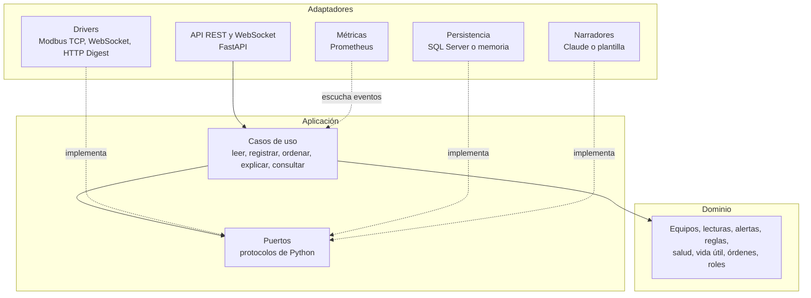
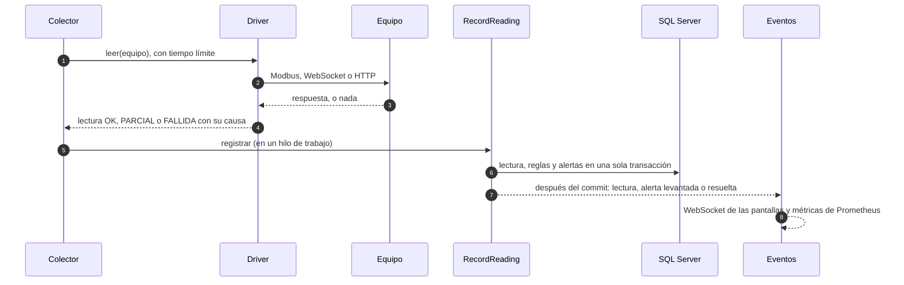
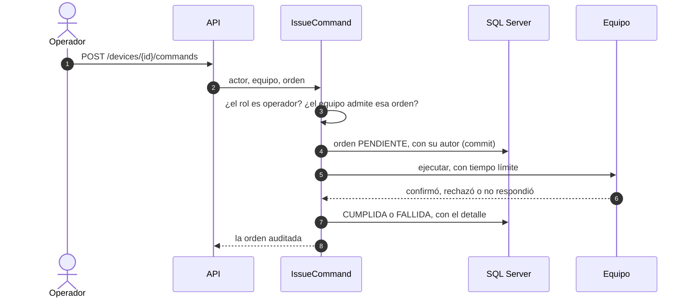

# Arquitectura

Kuntur sigue una arquitectura hexagonal (puertos y adaptadores). El dominio no conoce SQL Server,
FastAPI, Modbus ni Claude: solo reglas de negocio. Las dependencias apuntan siempre hacia adentro.

| Capa | Paquete | Qué contiene |
|---|---|---|
| Dominio | `kuntur.domain` | Entidades y reglas puras: alertas confirmadas, histéresis, salud, relojes de vida útil, órdenes auditadas, permisos. Sin E/S. |
| Aplicación | `kuntur.application` | Casos de uso (`RecordReading`, `PollDevice`, `IssueCommand`, `ExplainAlert`, `FleetQueries`, el colector) y los puertos que necesitan. |
| Adaptadores | `kuntur.adapters` | Implementaciones de los puertos: drivers de protocolo, SQL Server, unidad de trabajo en memoria, JWT y Argon2, narradores, API, métricas. |
| Composición | `kuntur.bootstrap` | El único lugar que conoce las piezas concretas y las conecta. |

## Una lectura, de punta a punta

- El driver **nunca lanza** por una falla del equipo: devuelve una lectura fallida con una causa de la
  taxonomía cerrada (sin respuesta, conexión rechazada, sin ruta, conexión cortada, credenciales,
  protocolo, valores imposibles, falla del equipo o desconocida).
- Las reglas y las alertas se aplican **en la misma transacción** que guarda la lectura; los eventos
  salen **después del commit**, así nadie se entera de algo que se deshizo.
- El colector lee toda la flota cada pocos segundos, con un máximo de lecturas simultáneas, y una
  falla en un equipo nunca detiene la ronda.

## Una orden, de punta a punta

La orden queda auditada **antes** de llegar al equipo: aunque el proceso muera a mitad de camino,
el intento consta. Un reinicio exitoso abre una ventana de caída esperada (90 s) en la que el silencio
de la cámara no es una pérdida de comunicación.

## Puertos

| Puerto | Adaptadores |
|---|---|
| `UnitOfWork` y sus repositorios | SQL Server (SQLAlchemy Core) y memoria, probados con el mismo contrato |
| `DeviceDriver` | `ModbusUpsDriver`, `WebSocketBarrierDriver`, `HttpCameraDriver` |
| `IncidentNarrator` | `ClaudeNarrator` (Anthropic) y `TemplateNarrator` |
| `TokenService`, `PasswordHasher` | JWT HS256 y Argon2id |
| `EventPublisher` | Bus en proceso: hub WebSocket y métricas |
| `Clock`, `IdGenerator` | Reloj del sistema y UUID; falsos en las pruebas |

## El simulador

`simulator/` es un paquete aparte, sin dependencias del backend: hace de campo. Cada equipo tiene un
modelo físico determinista (con semilla), su servidor de protocolo y un **proxy TCP de fallas** delante,
que corta, cuelga, demora o hace parpadear la red. Los escenarios registran la verdad de terreno con la
que se mide la [calidad de las alertas](calidad-de-alertas.md).
